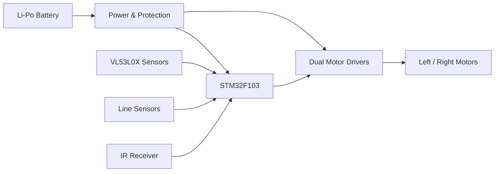

<p align="center">
  
</p>

# HAKUHO Hardware

### Custom Embedded Electronics for an Autonomous Sumo Robot

HAKUHO is a custom embedded hardware platform designed for an autonomous sumo robot.

The board brings together processing, motor control, distance sensing, line detection, power management and external interfaces on a single PCB intended for compact robotic integration.

---

## Hardware Architecture



---

## Main Hardware

| Block | Implementation |
|---|---|
| MCU | STM32F103C8T6 |
| Motor Control | TB6612FNG dual motor drivers |
| Distance Sensing | VL53L0X ToF sensors |
| Line Detection | External line sensors |
| IR Interface | IR receiver |
| Logic Rail | 3.3 V |
| Power Source | Li-Po battery |
| Protection | MOSFET reverse-polarity protection |

---

## PCB Design

The PCB integrates the robot's main electronic functions into a compact control platform.

<p align="center">
  
</p>

The design includes:

- STM32 processing core
- motor-driver stages
- multi-sensor interfaces
- I²C distribution for VL53L0X sensors
- line-sensor inputs
- IR receiver interface
- regulated power rails
- reverse-polarity protection
- programming / debug access
- robot interconnects

---

## Repository Contents

```text
HAKUHO/
│
├── docs/
│   ├── system_block_diagram.png
│   ├── pcb_preview.png
│   └── Sumo.gif
│
├── schematics/
│   └── Altium schematic files
│
├── pcb/
│   └── PCB layout files
│
├── libraries/
│   └── Custom symbols and footprints
│
├── production/
│   ├── Gerbers
│   └── BOM
│
└── README.md
```

---

## Design Tools

- Altium Designer
- SnapEDA
- STM32 ecosystem
- Git / GitHub

---

## Project Focus

HAKUHO was designed around one main idea:

> Build a compact robot-control platform where sensing, processing, power and motor control are integrated into one coherent embedded system.

---

## Author

**Mohamed Reda EZ-ZOUHRY**  
Embedded Systems & Control Engineering
